<picture>
  <source media="(max-width: 900px) and (prefers-color-scheme: dark)" srcset="assets/hero/hero-dark-mobile.svg">
  <source media="(max-width: 900px) and (prefers-color-scheme: light)" srcset="assets/hero/hero-light-mobile.svg">
  <source media="(prefers-color-scheme: dark)" srcset="assets/hero/hero-dark.svg?v=luxury-20261016">
  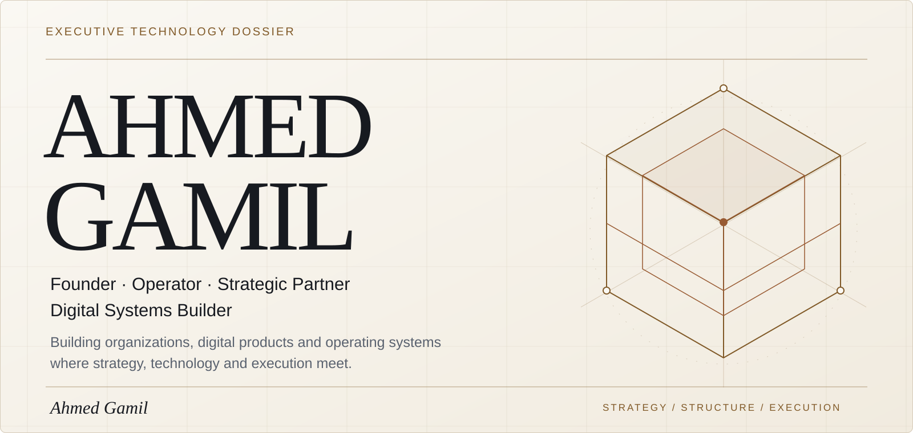
</picture>

<picture>
  <source media="(max-width: 900px) and (prefers-color-scheme: dark)" srcset="assets/dossier/identity-strip-dark-mobile.svg">
  <source media="(max-width: 900px) and (prefers-color-scheme: light)" srcset="assets/dossier/identity-strip-light-mobile.svg">
  <source media="(prefers-color-scheme: dark)" srcset="assets/dossier/identity-strip-dark.svg">
  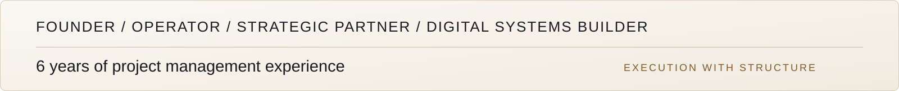
</picture>

[PROFILE](#user-content-profile) · [VENTURES](#user-content-ventures) · [SYSTEMS](#user-content-systems) · [CAPABILITIES](#user-content-capabilities) · [PRINCIPLES](#user-content-principles) · [GITHUB](#user-content-github) · [CONNECT](#user-content-connect)

##  01 / Executive Profile

<picture>
  <source media="(max-width: 900px) and (prefers-color-scheme: dark)" srcset="assets/dossier/profile-dark-mobile.svg">
  <source media="(max-width: 900px) and (prefers-color-scheme: light)" srcset="assets/dossier/profile-light-mobile.svg">
  <source media="(prefers-color-scheme: dark)" srcset="assets/dossier/profile-dark.svg">
  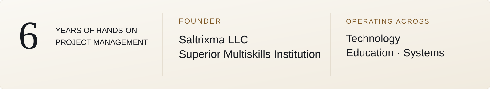
</picture>

I work across technology, education, digital products and institutional systems. With **6 years of hands-on project management experience**, I turn complex requirements into operating structures, products, workflows and technical systems.

My work connects strategy with execution: defining what should be built, structuring how it should operate, and coordinating delivery around real organizational needs.

##  02 / Leadership & Ventures

<h3>
<picture>
  <source media="(max-width: 900px) and (prefers-color-scheme: dark)" srcset="assets/dossier/venture-saltrixma-dark-mobile.webp">
  <source media="(max-width: 900px) and (prefers-color-scheme: light)" srcset="assets/dossier/venture-saltrixma-light-mobile.webp">
  <source media="(prefers-color-scheme: dark)" srcset="assets/dossier/venture-saltrixma-dark.webp">
  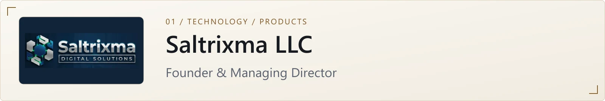
</picture>
</h3>

**Founder & Managing Director**  
A digital systems and technology venture building products, operational tools and structured technical solutions. QADHA is its flagship digital product.

[Company website →](https://saltrixma.com)

<h3>
<picture>
  <source media="(max-width: 900px) and (prefers-color-scheme: dark)" srcset="assets/dossier/venture-smi-dark-mobile.webp">
  <source media="(max-width: 900px) and (prefers-color-scheme: light)" srcset="assets/dossier/venture-smi-light-mobile.webp">
  <source media="(prefers-color-scheme: dark)" srcset="assets/dossier/venture-smi-dark.webp">
  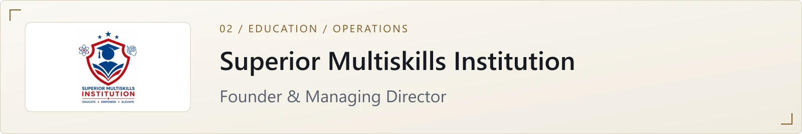
</picture>
</h3>

**Founder & Managing Director**  
An operating education institution combining English-language learning, structured academic operations, secondary practice and mental training, supported by digital systems.

<h3>
<picture>
  <source media="(max-width: 900px) and (prefers-color-scheme: dark)" srcset="assets/dossier/venture-flunex-dark-mobile.webp">
  <source media="(max-width: 900px) and (prefers-color-scheme: light)" srcset="assets/dossier/venture-flunex-light-mobile.webp">
  <source media="(prefers-color-scheme: dark)" srcset="assets/dossier/venture-flunex-dark.webp">
  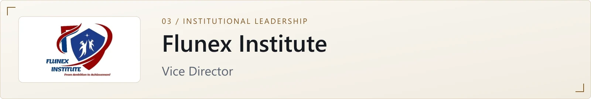
</picture>
</h3>

**Vice Director**  
Education and institutional leadership focused on operations and program execution.

[Institute website →](https://flunexinstitute.com)

<h3>
<picture>
  <source media="(max-width: 900px) and (prefers-color-scheme: dark)" srcset="assets/dossier/venture-scholarships-dark-mobile.webp">
  <source media="(max-width: 900px) and (prefers-color-scheme: light)" srcset="assets/dossier/venture-scholarships-light-mobile.webp">
  <source media="(prefers-color-scheme: dark)" srcset="assets/dossier/venture-scholarships-dark.webp">
  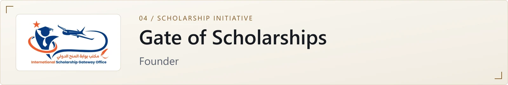
</picture>
</h3>

**Founder**  
A scholarship-focused initiative.

##  03 / Featured Systems

<h3>
<a href="assets/projects/qadha-operations.webp">
<picture>
  <source media="(max-width: 900px) and (prefers-color-scheme: dark)" srcset="assets/dossier/qadha-dark-mobile.webp">
  <source media="(max-width: 900px) and (prefers-color-scheme: light)" srcset="assets/dossier/qadha-light-mobile.webp">
  <source media="(prefers-color-scheme: dark)" srcset="assets/dossier/qadha-dark.webp">
  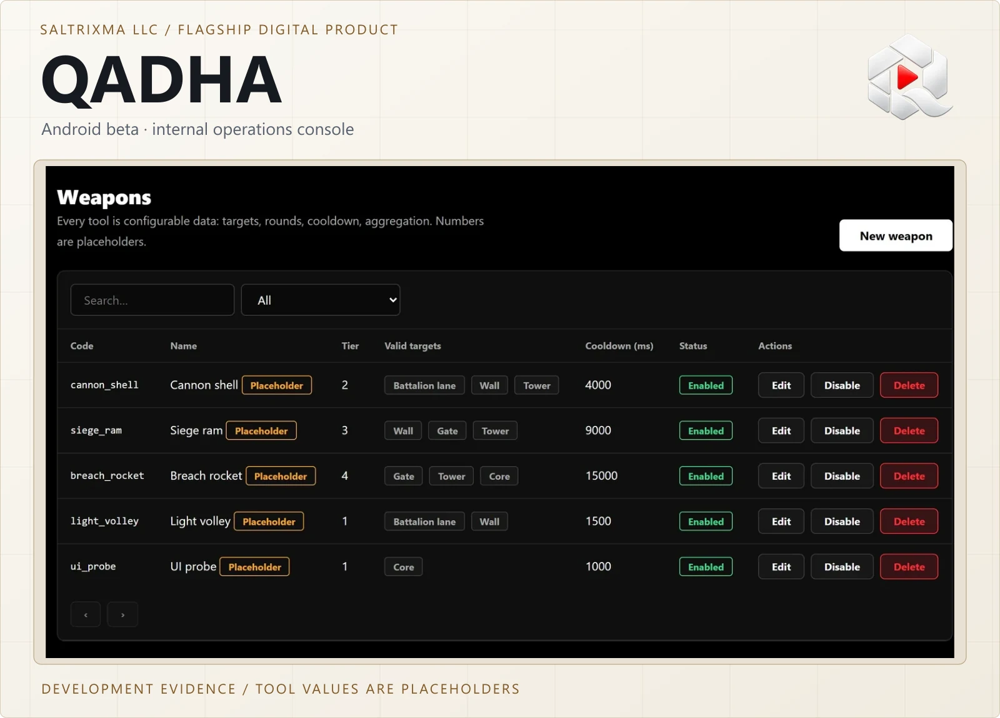
</picture>
</a>
</h3>

**Flagship digital product developed under Saltrixma LLC**

A social video and challenge application bringing content, interaction, messaging, competitive rounds, teams and gifting concepts into one product, with an operational administration layer.

**My role:** product direction, operating model, requirements, system definition and execution oversight under Saltrixma LLC.

- **Mobile application:** Android beta; iOS release pending.
- **Operations console:** internal.
- **Battle authority:** built; the media layer is simulated.
- **Economy and ledgers:** demo / test economy, with no real payments connected.
- **Authorized content migration:** internal, with a rights gate.

Live video integration, cinematic battle rendering, app-store billing and payouts remain proposed.

[Inspect the full-size console capture →](assets/projects/qadha-operations.webp)

Operations-console evidence from the executive portfolio. Internal development environment; tool values are placeholders. Open the image for detail. This capture does not establish public launch or live video availability.

**Documented technology:** React Native · Expo · Next.js console · PostgreSQL.  
[Public product website →](https://qadhaapp.com)

<h3>
<picture>
  <source media="(max-width: 900px) and (prefers-color-scheme: dark)" srcset="assets/dossier/smi-dark-mobile.webp">
  <source media="(max-width: 900px) and (prefers-color-scheme: light)" srcset="assets/dossier/smi-light-mobile.webp">
  <source media="(prefers-color-scheme: dark)" srcset="assets/dossier/smi-dark.webp">
  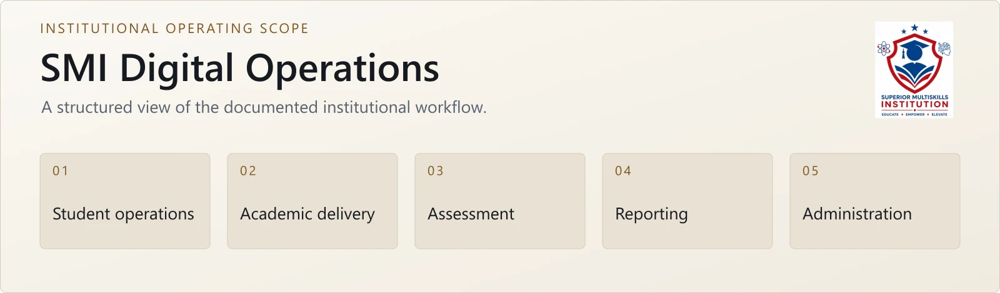
</picture>
</h3>

Coordinating student, academic, assessment, reporting and administrative workflows inside Superior Multiskills Institution.

**My role:** Founder & Managing Director — institutional operating model, requirements, execution and system oversight.

The documented operating scope includes Student Gateway, attendance, sessions, learning materials and homework, assessments, progress reports, certificates, scheduling, teacher/admin operations and mental training.

Operating scope is documented in the institutional record. Approved operational screenshots and public deployment evidence are not yet available.

## 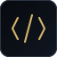 04 / Technical Operating Stack

<h3>
<picture>
  <source media="(max-width: 900px) and (prefers-color-scheme: dark)" srcset="assets/dossier/capability-frontend-dark-mobile.svg">
  <source media="(max-width: 900px) and (prefers-color-scheme: light)" srcset="assets/dossier/capability-frontend-light-mobile.svg">
  <source media="(prefers-color-scheme: dark)" srcset="assets/dossier/capability-frontend-dark.svg">
  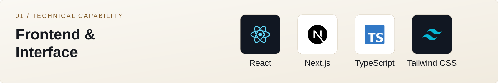
</picture>
</h3>

HTML5 · CSS3 · Tailwind CSS · JavaScript · TypeScript · React · Next.js

<h3>
<picture>
  <source media="(max-width: 900px) and (prefers-color-scheme: dark)" srcset="assets/dossier/capability-backend-dark-mobile.svg">
  <source media="(max-width: 900px) and (prefers-color-scheme: light)" srcset="assets/dossier/capability-backend-light-mobile.svg">
  <source media="(prefers-color-scheme: dark)" srcset="assets/dossier/capability-backend-dark.svg">
  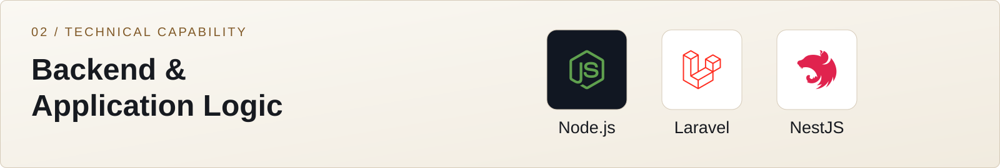
</picture>
</h3>

PHP · Laravel · Node.js · Express.js · NestJS

<h3>
<picture>
  <source media="(max-width: 900px) and (prefers-color-scheme: dark)" srcset="assets/dossier/capability-data-dark-mobile.svg">
  <source media="(max-width: 900px) and (prefers-color-scheme: light)" srcset="assets/dossier/capability-data-light-mobile.svg">
  <source media="(prefers-color-scheme: dark)" srcset="assets/dossier/capability-data-dark.svg">
  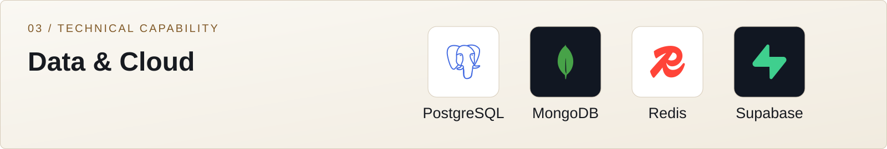
</picture>
</h3>

MySQL · PostgreSQL · MongoDB · Redis · Supabase · Cloudflare R2

<h3>
<picture>
  <source media="(max-width: 900px) and (prefers-color-scheme: dark)" srcset="assets/dossier/capability-mobile-dark-mobile.svg">
  <source media="(max-width: 900px) and (prefers-color-scheme: light)" srcset="assets/dossier/capability-mobile-light-mobile.svg">
  <source media="(prefers-color-scheme: dark)" srcset="assets/dossier/capability-mobile-dark.svg">
  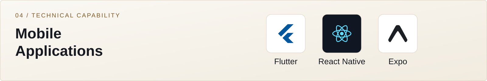
</picture>
</h3>

Flutter · React Native · Expo · Mobile Backend Integration

<h3>
<picture>
  <source media="(max-width: 900px) and (prefers-color-scheme: dark)" srcset="assets/dossier/capability-infrastructure-dark-mobile.svg">
  <source media="(max-width: 900px) and (prefers-color-scheme: light)" srcset="assets/dossier/capability-infrastructure-light-mobile.svg">
  <source media="(prefers-color-scheme: dark)" srcset="assets/dossier/capability-infrastructure-dark.svg">
  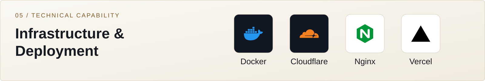
</picture>
</h3>

Docker · cPanel Administration · Domain & DNS Management · Cloudflare · Nginx · Vercel

<h3>
<picture>
  <source media="(max-width: 900px) and (prefers-color-scheme: dark)" srcset="assets/dossier/capability-api-dark-mobile.svg">
  <source media="(max-width: 900px) and (prefers-color-scheme: light)" srcset="assets/dossier/capability-api-light-mobile.svg">
  <source media="(prefers-color-scheme: dark)" srcset="assets/dossier/capability-api-dark.svg">
  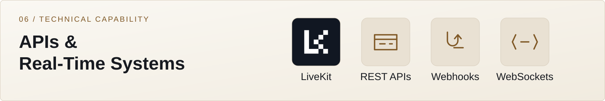
</picture>
</h3>

REST API Development · Third-Party API Integration · Webhooks · WebSockets · LiveKit

<h3>
<picture>
  <source media="(max-width: 900px) and (prefers-color-scheme: dark)" srcset="assets/dossier/capability-security-dark-mobile.svg">
  <source media="(max-width: 900px) and (prefers-color-scheme: light)" srcset="assets/dossier/capability-security-light-mobile.svg">
  <source media="(prefers-color-scheme: dark)" srcset="assets/dossier/capability-security-dark.svg">
  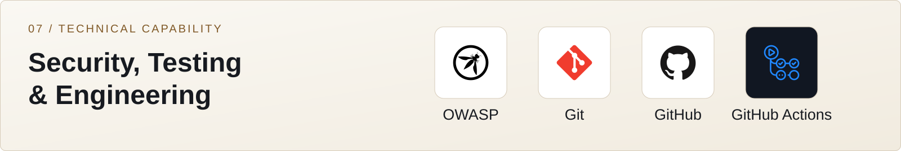
</picture>
</h3>

OWASP Top 10 · Playwright · Git & GitHub · GitHub Actions

<h3>
<picture>
  <source media="(max-width: 900px) and (prefers-color-scheme: dark)" srcset="assets/dossier/capability-architecture-dark-mobile.svg">
  <source media="(max-width: 900px) and (prefers-color-scheme: light)" srcset="assets/dossier/capability-architecture-light-mobile.svg">
  <source media="(prefers-color-scheme: dark)" srcset="assets/dossier/capability-architecture-dark.svg">
  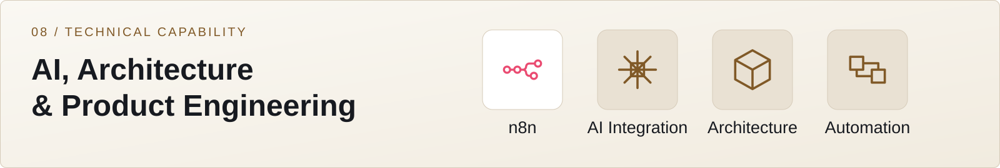
</picture>
</h3>

OpenAI API Integration · n8n Automation · System Architecture · Full-Stack Integration · Requirements Analysis · Technical Project Planning

Technology mark sources and attribution: <a href="THIRD_PARTY_NOTICES.md">third-party notices</a>.

##  05 / Verified Milestones

<picture>
  <source media="(max-width: 900px) and (prefers-color-scheme: dark)" srcset="assets/dossier/milestones-dark-mobile.svg">
  <source media="(max-width: 900px) and (prefers-color-scheme: light)" srcset="assets/dossier/milestones-light-mobile.svg">
  <source media="(prefers-color-scheme: dark)" srcset="assets/dossier/milestones-dark.svg">
  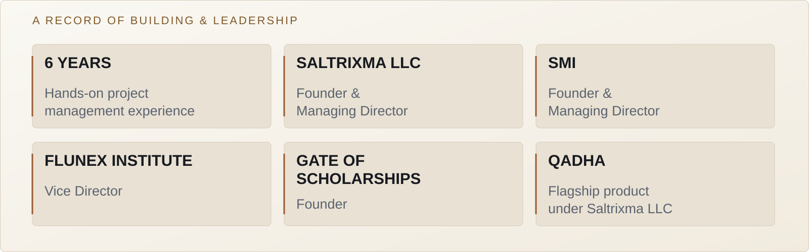
</picture>

- Founded Saltrixma LLC, Superior Multiskills Institution and Gate of Scholarships.
- Serves as Vice Director of Flunex Institute.
- Directed QADHA’s product definition and development under Saltrixma LLC.
- Structured digital operating models around education and institutional workflows.

##  06 / Operating Principles

<picture>
  <source media="(max-width: 900px) and (prefers-color-scheme: dark)" srcset="assets/dossier/principles-dark-mobile.svg">
  <source media="(max-width: 900px) and (prefers-color-scheme: light)" srcset="assets/dossier/principles-light-mobile.svg">
  <source media="(prefers-color-scheme: dark)" srcset="assets/dossier/principles-dark.svg">
  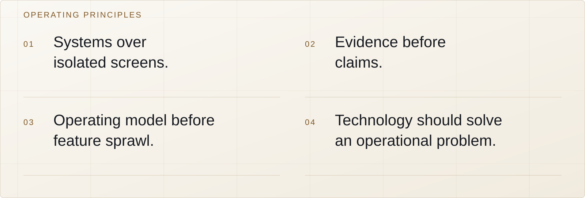
</picture>

**Start with the operation.** Understand the organization, its people and its constraints before choosing technology.

**Build connected systems.** Define the workflow, responsibilities and rules before expanding the feature set.

**Make the work visible.** Ownership, decisions and operational evidence should be clear to the people running the system.

**Let evidence set the claim.** Product status, technical scope and public proof should stay aligned.

<picture>
  <source media="(max-width: 900px) and (prefers-color-scheme: dark)" srcset="assets/dossier/workflow-dark-mobile.svg">
  <source media="(max-width: 900px) and (prefers-color-scheme: light)" srcset="assets/dossier/workflow-light-mobile.svg">
  <source media="(prefers-color-scheme: dark)" srcset="assets/dossier/workflow-dark.svg">
  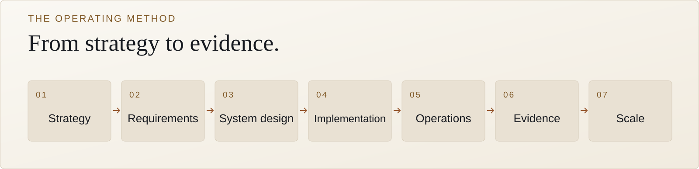
</picture>

An operating method: define the need, build the system, run the workflow and validate the evidence before scaling.

##  07 / GitHub Activity

<picture>
  <source media="(max-width: 900px) and (prefers-color-scheme: dark)" srcset="assets/dossier/github-dark-mobile.svg">
  <source media="(max-width: 900px) and (prefers-color-scheme: light)" srcset="assets/dossier/github-light-mobile.svg">
  <source media="(prefers-color-scheme: dark)" srcset="assets/dossier/github-dark.svg">
  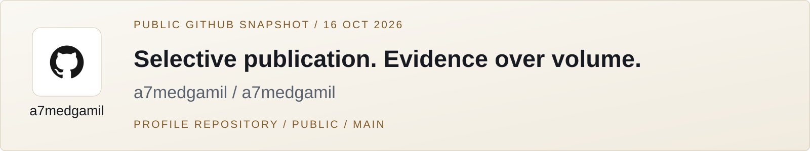
</picture>

Public repositories are used selectively for work intended for open publication. The products and institutional systems described above are represented here through public-safe evidence; their source code is not published in this profile.

[Explore public repositories →](https://github.com/a7medgamil?tab=repositories)

##  08 / Professional Connections

<picture>
  <source media="(max-width: 900px) and (prefers-color-scheme: dark)" srcset="assets/dossier/connect-dark-mobile.svg">
  <source media="(max-width: 900px) and (prefers-color-scheme: light)" srcset="assets/dossier/connect-light-mobile.svg">
  <source media="(prefers-color-scheme: dark)" srcset="assets/dossier/connect-dark.svg">
  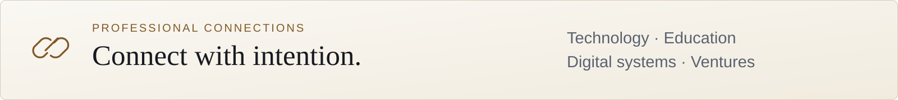
</picture>

[GitHub · a7medgamil](https://github.com/a7medgamil) · [ahmed@saltrixma.com](mailto:ahmed@saltrixma.com)

##  09 / Partnership

<a href="https://saltrixma.com/contact">
<picture>
  <source media="(max-width: 900px) and (prefers-color-scheme: dark)" srcset="assets/dossier/cta-dark-mobile.svg">
  <source media="(max-width: 900px) and (prefers-color-scheme: light)" srcset="assets/dossier/cta-light-mobile.svg">
  <source media="(prefers-color-scheme: dark)" srcset="assets/dossier/cta-dark.svg">
  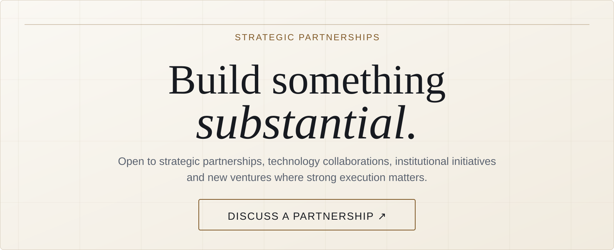
</picture>
</a>

Open to strategic partnerships, technology collaborations, institutional initiatives and new ventures where strong execution matters.

**[Discuss a Partnership →](https://saltrixma.com/contact)**

<picture>
  <source media="(max-width: 900px) and (prefers-color-scheme: dark)" srcset="assets/dossier/signature-dark-mobile.svg">
  <source media="(max-width: 900px) and (prefers-color-scheme: light)" srcset="assets/dossier/signature-light-mobile.svg">
  <source media="(prefers-color-scheme: dark)" srcset="assets/dossier/signature-dark.svg">
  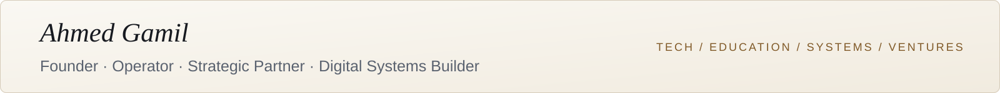
</picture>
