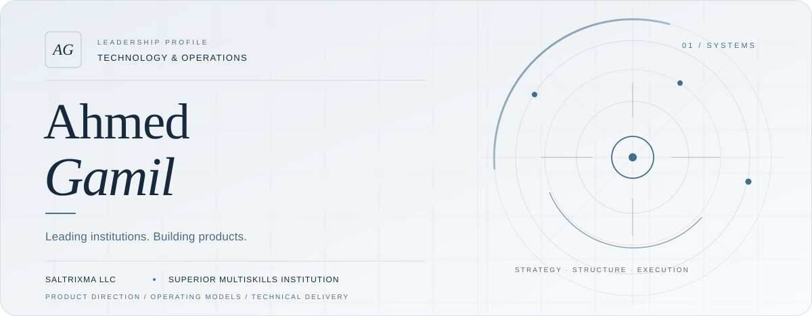
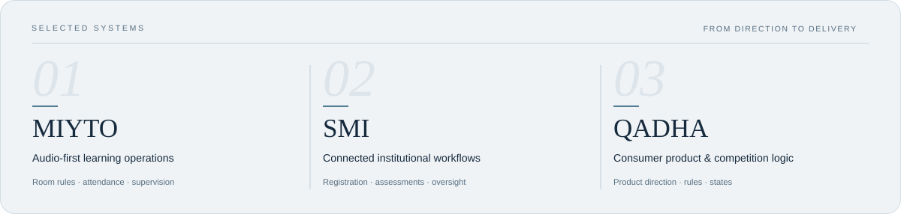

  <picture>
    <source media="(max-width: 650px) and (prefers-color-scheme: dark)" srcset="assets/executive/hero-mobile-dark.svg">
    <source media="(max-width: 650px) and (prefers-color-scheme: light)" srcset="assets/executive/hero-mobile-light.svg">
    <source media="(prefers-color-scheme: dark)" srcset="assets/executive/hero-dark.svg">
    
  </picture>

  <a href="https://ahmed-gamil-portfolio.ahmedabdulbarim.workers.dev/"><strong>EXECUTIVE PORTFOLIO</strong></a>
  &nbsp;·&nbsp; <a href="#leadership">LEADERSHIP</a>
  &nbsp;·&nbsp; <a href="#selected-work">SELECTED WORK</a>
  &nbsp;·&nbsp; <a href="#evidence">EVIDENCE</a>
  &nbsp;·&nbsp; <a href="#contact">CONTACT</a>

---

### Strategy sets direction. Systems make it executable.

I work at the intersection of **institutional leadership, product direction and technology delivery**. As **CEO of Saltrixma LLC** and **Founder & Managing Director of Superior Multiskills Institution (SMI)**, I focus on making complex work operational: defining the problem, establishing the operating model, guiding implementation and examining what is actually delivered.

A product is not just an interface. An institution is not just a set of departments. Both need clear decisions, accountable workflows and systems people can use.

## 01 / Leadership

**Saltrixma LLC — Chief Executive Officer**  
Direction for software products, business systems and technical delivery. The work spans product definition, execution priorities, operating decisions and the teams and processes behind them. [Company website](https://saltrixma.com) · [Portfolio record](https://ahmed-gamil-portfolio.ahmedabdulbarim.workers.dev/saltrixma)

**Superior Multiskills Institution — Founder & Managing Director**  
Leadership of an education institution and its digital operating environment, connecting program delivery with learner registration, attendance, assessment, administration and supervision. [Institutional case study](https://github.com/a7medgamil/smi-digital-operations-showcase) · [SMI portfolio](https://ahmed-gamil-portfolio.ahmedabdulbarim.workers.dev/smi)

**Additional institutional experience**  
Vice Director, **Flunex Institute**, and Founder, **Gate of Scholarships**. These are distinct leadership and education-access initiatives, not subsidiaries of Saltrixma. [Leadership background](https://ahmed-gamil-portfolio.ahmedabdulbarim.workers.dev/profile)

## 02 / Selected work

  <picture>
    <source media="(max-width: 650px) and (prefers-color-scheme: dark)" srcset="assets/executive/systems-mobile-dark.svg">
    <source media="(max-width: 650px) and (prefers-color-scheme: light)" srcset="assets/executive/systems-mobile-light.svg">
    <source media="(prefers-color-scheme: dark)" srcset="assets/executive/systems-dark.svg">
    
  </picture>

**MIYTO Smart Rooms** — *Learning operations and product governance*  
Directed the design of structured audio-practice rooms: level-aware matching, timed sessions, attendance rules and supervisor intervention. The publicly inspectable lab is a **fictional simulation** of selected room-state decisions—not the live audio infrastructure.  
[Case study](https://github.com/a7medgamil/miyto-smart-rooms-showcase) · [Original runnable simulation](https://github.com/a7medgamil/miyto-smart-rooms-showcase/tree/main/demo/room-state-lab) · [26 tests / CI](https://github.com/a7medgamil/miyto-smart-rooms-showcase/actions/runs/44894982610)

**SMI Digital Operations** — *Institutional transformation*  
Defined connected academic and administrative workflows across student access, registration, attendance, assessment and institutional oversight. A separate synthetic case lab demonstrates workflow rules without exposing learner records.  
[Operating model](https://github.com/a7medgamil/smi-digital-operations-showcase) · [Original operations lab](https://github.com/a7medgamil/smi-digital-operations-showcase/tree/main/demo/operations-case-lab) · [39 tests / CI](https://github.com/a7medgamil/smi-digital-operations-showcase/actions/runs/44895321053)

**QADHA Platform** — *Consumer product direction*  
Directed the product structure for a social-video and challenge concept, including competition rules and the systems needed to operate it. The public battle-rules lab is independent of private application code; it does **not** represent live video, payments or a production launch.  
[Product case study](https://github.com/a7medgamil/qadha-platform-showcase) · [Original rules lab](https://github.com/a7medgamil/qadha-platform-showcase/tree/main/demo/battle-rule-lab) · [36 tests / CI](https://github.com/a7medgamil/qadha-platform-showcase/actions/runs/44896934520)

## 03 / Evidence, not adjectives

The public repositories above contain **original, executable examples with automated checks**. They demonstrate selected technical rules and delivery discipline; private operational source, student data and confidential company materials stay private.

**Academic work:** [AIU Smart HR](https://github.com/a7medgamil/aiu-smart-hr-showcase) documents an academic HR-system design with fictional interface previews. It is **not** presented as a deployed AI model or a working recruitment service.

**Working method:** define the operating problem → establish ownership and rules → coordinate implementation → validate behavior → improve the system.

**Technical context:** JavaScript / TypeScript · Node.js · PHP · React / React Native · SQL · Cloudflare · automated testing and delivery workflows. Technologies describe documented project context, not a claim of expertise in every tool.

## 04 / Professional conversation

I welcome considered conversations about **technology-enabled operations, product leadership, digital transformation and remote technical delivery**—where the work requires both organizational judgement and the ability to see execution through.

  <strong><a href="https://ahmed-gamil-portfolio.ahmedabdulbarim.workers.dev/">VIEW EXECUTIVE PORTFOLIO</a></strong>
  &nbsp;·&nbsp; <a href="mailto:ahmed@saltrixma.com">PROFESSIONAL EMAIL</a>
  &nbsp;·&nbsp; <a href="https://saltrixma.com/contact">COMPANY CONTACT</a>

  Public work samples are intentionally separated from private organizational systems. Case studies distinguish implemented behavior, simulations and work still under development.

