

<picture>
  <source media="(max-width: 900px) and (prefers-color-scheme: dark)" srcset="assets/hero/hero-centered-dark-mobile.svg">
  <source media="(max-width: 900px) and (prefers-color-scheme: light)" srcset="assets/hero/hero-centered-light-mobile.svg">
  <source media="(prefers-color-scheme: dark)" srcset="assets/hero/hero-centered-dark.svg">
  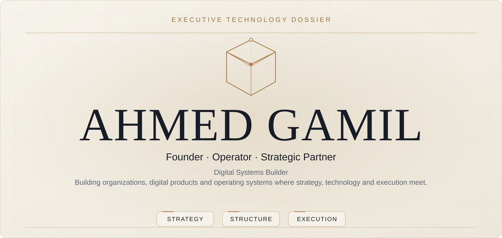
</picture>

<a href="#user-content-profile">PROFILE</a> · <a href="#user-content-ventures">VENTURES</a> · <a href="#user-content-systems">SYSTEMS</a> · <a href="#user-content-capabilities">CAPABILITIES</a> · <a href="#user-content-principles">PRINCIPLES</a> · <a href="#user-content-github">GITHUB</a> · <a href="#user-content-connect">CONNECT</a> · <a href="https://ahmed-gamil-portfolio.ahmedabdulbarim.workers.dev">PORTFOLIO</a>

<h2 align="center"> 01 / Executive Profile</h2>

<picture>
  <source media="(max-width: 900px) and (prefers-color-scheme: dark)" srcset="assets/dossier/profile-card-dark-mobile.svg">
  <source media="(max-width: 900px) and (prefers-color-scheme: light)" srcset="assets/dossier/profile-card-light-mobile.svg">
  <source media="(prefers-color-scheme: dark)" srcset="assets/dossier/profile-card-dark.svg">
  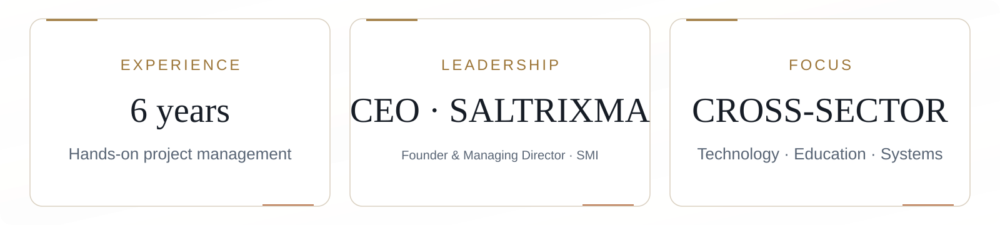
</picture>

I work across technology, education, digital products and institutional systems. With **6 years of project and operations management experience**, I turn complex requirements into operating structures, products, workflows and technical systems.

My work connects strategy with execution: defining what should be built, structuring how it should operate, and coordinating delivery around real organizational needs.

### Academic Foundation & Journey

The foundation of my journey was built through academic discipline and selective education:

1. **Secondary school:** ranked among Yemen's top 10 students nationally, achieving **98.88%**.
2. **Gifted education:** admitted to **Jamal Abdul Nasser School for Gifted Students**, selected among approximately **200 students from 1,200 applicants**.
3. **International scholarship:** awarded an **AIU scholarship covering tuition, university housing, a monthly stipend, and medical insurance** to pursue an **undergraduate degree in Computer Science at Albukhary International University (AIU)**.
4. **Professional development:** built six years of hands-on experience in project and operations management, translating academic discipline into institutional execution.
5. **Leadership today:** CEO of Saltrixma LLC; Founder & Managing Director of Superior Multiskills Institution; Vice Director of Flunex Institute; and Founder of Gate of Scholarships.

<h2 align="center"> 02 / Leadership &amp; Ventures</h2>

Leadership roles across technology, education and scholarship initiatives.

<picture>
  <source media="(max-width: 900px) and (prefers-color-scheme: dark)" srcset="assets/dossier/ventures-grid-dark-mobile.webp">
  <source media="(max-width: 900px) and (prefers-color-scheme: light)" srcset="assets/dossier/ventures-grid-light-mobile.webp">
  <source media="(prefers-color-scheme: dark)" srcset="assets/dossier/ventures-grid-dark.webp">
  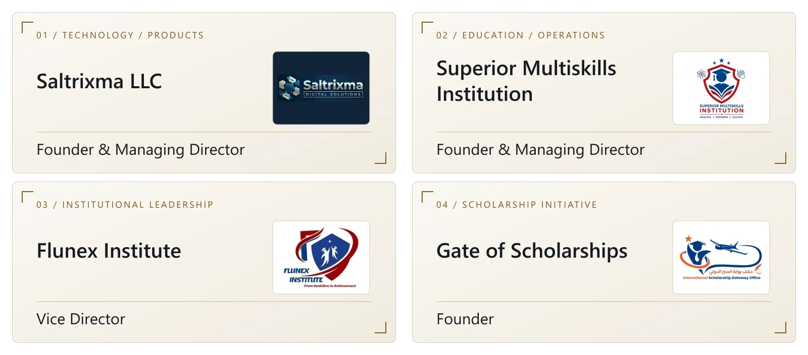
</picture>

- **Saltrixma LLC:** CEO — a digital systems and technology venture building products, operational tools and structured technical solutions. QADHA is its flagship digital product.
- **Superior Multiskills Institution:** Founder & Managing Director — an operating education institution combining English-language learning, structured academic operations, secondary practice and mental training, supported by digital systems.
- **Educational impact:** Over the past three years, trained thousands of students, supporting learners who went on to achieve places among Yemen's top students nationally.
- **Flunex Institute:** Education and institutional leadership focused on operations and program execution.
- **Gate of Scholarships:** A scholarship-focused initiative.

<a href="https://saltrixma.com">Saltrixma website</a> · <a href="https://flunexinstitute.com">Flunex Institute</a> · <a href="https://ahmed-gamil-portfolio.ahmedabdulbarim.workers.dev/leadership/flunex">Flunex leadership record</a> · <a href="https://ahmed-gamil-portfolio.ahmedabdulbarim.workers.dev/leadership/gate-of-scholarships">Gate of Scholarships record</a>

<h2 align="center"> 03 / Featured Systems</h2>

<a href="assets/projects/qadha-operations.webp">
<picture>
  <source media="(max-width: 900px) and (prefers-color-scheme: dark)" srcset="assets/dossier/qadha-dark-mobile.webp">
  <source media="(max-width: 900px) and (prefers-color-scheme: light)" srcset="assets/dossier/qadha-light-mobile.webp">
  <source media="(prefers-color-scheme: dark)" srcset="assets/dossier/qadha-dark.webp">
  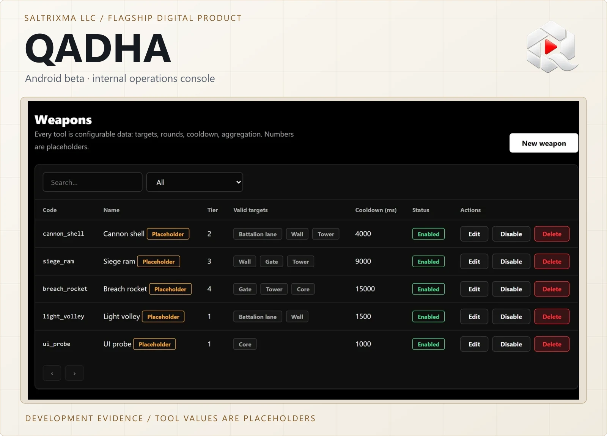
</picture>
</a>

**Flagship digital product developed under Saltrixma LLC**

A social video and challenge application bringing content, interaction, messaging, competitive rounds, teams and gifting concepts into one product, with an operational administration layer.

**My role:** product direction, operating model, requirements, system definition and execution oversight under Saltrixma LLC.

- **Mobile application:** Android beta; iOS release pending.
- **Operations console:** internal.
- **Battle authority:** built; the media layer is simulated.
- **Economy and ledgers:** demo / test economy, with no real payments connected.
- **Authorized content migration:** internal, with a rights gate.

Live video integration, cinematic battle rendering, app-store billing and payouts remain proposed.

[Inspect the full-size console capture →](assets/projects/qadha-operations.webp)

Operations-console evidence from the executive portfolio. Internal development environment; tool values are placeholders. Open the image for detail. This capture does not establish public launch or live video availability.

**Documented technology:** React Native · Expo · Next.js console · PostgreSQL.  
[Public product website →](https://qadhaapp.com) · [Product case study →](https://github.com/a7medgamil/qadha-platform-showcase) · [Saltrixma portfolio →](https://ahmed-gamil-portfolio.ahmedabdulbarim.workers.dev/saltrixma)

### MIYTO Smart Rooms — audio-first learning operations

MIYTO structures SMI's secondary training into paired, level-aware audio rooms. Learners move through timed silent-practice rounds before moderated speaking discussions, while attendance and supervisor actions are handled through defined operating rules.

- Paired rooms with automatic level-aware grouping.
- Three timed practice rounds: mental training, vocabulary and a second vocabulary round with mic and chat closed.
- A 20-question discussion board after the silent rounds.
- Minute-based attendance and conditional weekly assessment.
- Supervisor controls for broadcast, mute, transfer, chat lock and special time.

**My role:** Founder & Managing Director of SMI — product direction, requirements and operating rules.

[MIYTO product case study →](https://github.com/a7medgamil/miyto-smart-rooms-showcase) · [Portfolio case study →](https://ahmed-gamil-portfolio.ahmedabdulbarim.workers.dev/case-studies/miyto-smart-rooms) · [Student experience →](https://secondary-session.smi-platform.org/)

<picture>
  <source media="(max-width: 900px) and (prefers-color-scheme: dark)" srcset="assets/dossier/smi-dark-mobile.webp">
  <source media="(max-width: 900px) and (prefers-color-scheme: light)" srcset="assets/dossier/smi-light-mobile.webp">
  <source media="(prefers-color-scheme: dark)" srcset="assets/dossier/smi-dark.webp">
  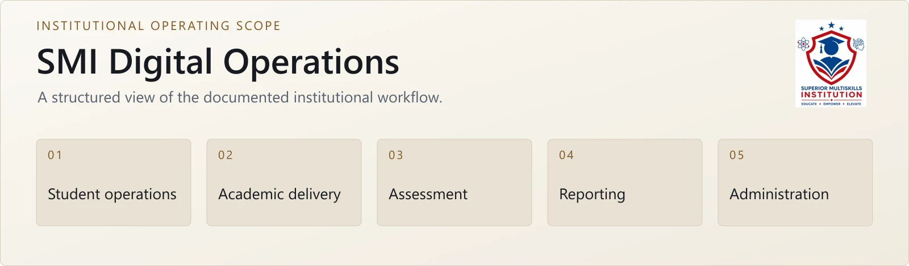
</picture>

Coordinating a documented 12-part digital environment across institutional access, learner platforms, registration, scholarships, course subscriptions, appointments, examinations, CRM and outreach.

**My role:** Founder & Managing Director — institutional operating model, requirements, execution and system oversight.

**Public route check · 15 Nov 2026:** the main SMI website, Secondary Training, Student Gateway, Scholarships, Course Subscription and SCI Appointments each returned HTTP 200. This confirms route reachability, not full workflow acceptance.

The inventory also records the Registration Hub, Registration Control Center, Scholarship Control Center, examinations within Student Gateway, CRM Leads and Outreach within Secondary Training. Staff-only routes and learner records are deliberately not published. The Registration Hub is separately documented as a specified workflow; its current release and route remain unverified.

[Explore the SMI portfolio record](https://ahmed-gamil-portfolio.ahmedabdulbarim.workers.dev/smi#digital-systems) · [Registration Hub case study](https://ahmed-gamil-portfolio.ahmedabdulbarim.workers.dev/case-studies/smi-registration-hub) · [Read the public system inventory](https://github.com/a7medgamil/smi-digital-operations-showcase/blob/main/docs/SYSTEM-INVENTORY.md)

### HR & NLP CV Summarizer — AIU Computer Science FYP

An academic design project exploring an HR portal to summarise and rank fewer than 10 CVs at a time against seven fixed dimensions: Qualifications, Experience, Location & Relocation, Soft and Hard Skills, References, Personal Information, and Rewards.

**My role:** Computer Science student, FYP contributor and designer. The ERD was approved for university submission. Cloudflare Pages and Workers were considered as hosting options; the project is not presented as deployed, and no model-accuracy or hiring-outcome claims are made.

[Public academic case study →](https://github.com/a7medgamil/aiu-smart-hr-showcase) · [Portfolio case study →](https://ahmed-gamil-portfolio.ahmedabdulbarim.workers.dev/case-studies/hr-nlp-cv-summarizer)

<h2 align="center"> 04 / Technical Operating Stack</h2>

A curated set of **43 selected capabilities across eight operating areas**. These describe the documented technical stack and work context; they are not proficiency ratings.

<picture>
  <source media="(max-width: 900px) and (prefers-color-scheme: dark)" srcset="assets/dossier/capability-frontend-dark-mobile.svg">
  <source media="(max-width: 900px) and (prefers-color-scheme: light)" srcset="assets/dossier/capability-frontend-light-mobile.svg">
  <source media="(prefers-color-scheme: dark)" srcset="assets/dossier/capability-frontend-dark.svg">
  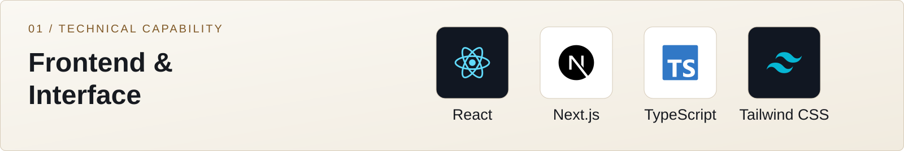
</picture>

HTML5 · CSS3 · Tailwind CSS · JavaScript · TypeScript · React · Next.js

<picture>
  <source media="(max-width: 900px) and (prefers-color-scheme: dark)" srcset="assets/dossier/capability-backend-dark-mobile.svg">
  <source media="(max-width: 900px) and (prefers-color-scheme: light)" srcset="assets/dossier/capability-backend-light-mobile.svg">
  <source media="(prefers-color-scheme: dark)" srcset="assets/dossier/capability-backend-dark.svg">
  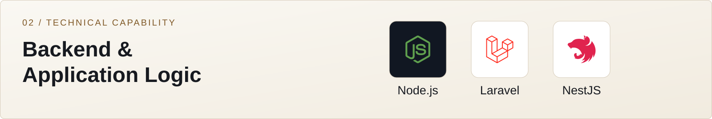
</picture>

PHP · Laravel · Node.js · Express.js · NestJS

<picture>
  <source media="(max-width: 900px) and (prefers-color-scheme: dark)" srcset="assets/dossier/capability-data-dark-mobile.svg">
  <source media="(max-width: 900px) and (prefers-color-scheme: light)" srcset="assets/dossier/capability-data-light-mobile.svg">
  <source media="(prefers-color-scheme: dark)" srcset="assets/dossier/capability-data-dark.svg">
  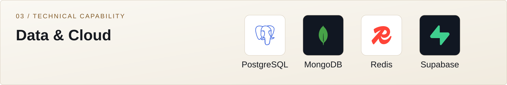
</picture>

MySQL · PostgreSQL · MongoDB · Redis · Supabase · Cloudflare R2

<picture>
  <source media="(max-width: 900px) and (prefers-color-scheme: dark)" srcset="assets/dossier/capability-mobile-dark-mobile.svg">
  <source media="(max-width: 900px) and (prefers-color-scheme: light)" srcset="assets/dossier/capability-mobile-light-mobile.svg">
  <source media="(prefers-color-scheme: dark)" srcset="assets/dossier/capability-mobile-dark.svg">
  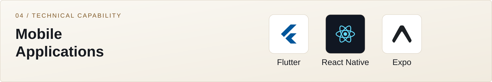
</picture>

Flutter · React Native · Expo · Mobile Backend Integration

<picture>
  <source media="(max-width: 900px) and (prefers-color-scheme: dark)" srcset="assets/dossier/capability-infrastructure-dark-mobile.svg">
  <source media="(max-width: 900px) and (prefers-color-scheme: light)" srcset="assets/dossier/capability-infrastructure-light-mobile.svg">
  <source media="(prefers-color-scheme: dark)" srcset="assets/dossier/capability-infrastructure-dark.svg">
  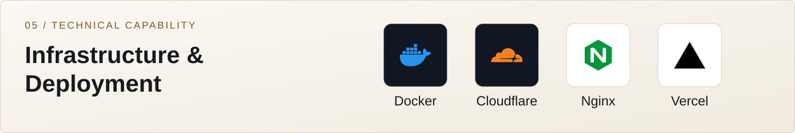
</picture>

Docker · cPanel Administration · Domain & DNS Management · Cloudflare · Nginx · Vercel

<picture>
  <source media="(max-width: 900px) and (prefers-color-scheme: dark)" srcset="assets/dossier/capability-api-dark-mobile.svg">
  <source media="(max-width: 900px) and (prefers-color-scheme: light)" srcset="assets/dossier/capability-api-light-mobile.svg">
  <source media="(prefers-color-scheme: dark)" srcset="assets/dossier/capability-api-dark.svg">
  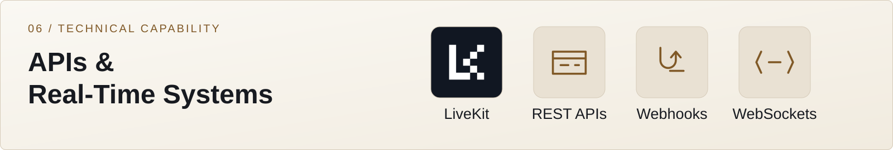
</picture>

REST API Development · Third-Party API Integration · Webhooks · WebSockets · LiveKit

<picture>
  <source media="(max-width: 900px) and (prefers-color-scheme: dark)" srcset="assets/dossier/capability-security-dark-mobile.svg">
  <source media="(max-width: 900px) and (prefers-color-scheme: light)" srcset="assets/dossier/capability-security-light-mobile.svg">
  <source media="(prefers-color-scheme: dark)" srcset="assets/dossier/capability-security-dark.svg">
  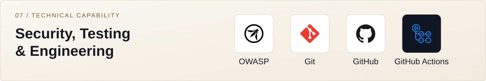
</picture>

OWASP Top 10 · Playwright · Git & GitHub · GitHub Actions

<picture>
  <source media="(max-width: 900px) and (prefers-color-scheme: dark)" srcset="assets/dossier/capability-architecture-dark-mobile.svg">
  <source media="(max-width: 900px) and (prefers-color-scheme: light)" srcset="assets/dossier/capability-architecture-light-mobile.svg">
  <source media="(prefers-color-scheme: dark)" srcset="assets/dossier/capability-architecture-dark.svg">
  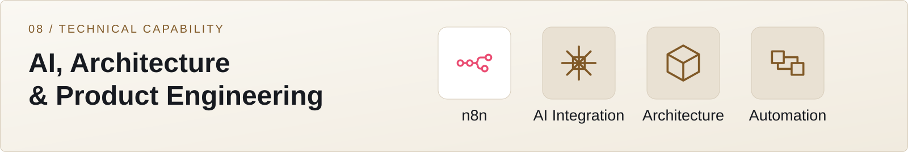
</picture>

OpenAI API Integration · n8n Automation · System Architecture · Full-Stack Integration · Requirements Analysis · Technical Project Planning

Technology mark sources and attribution: <a href="THIRD_PARTY_NOTICES.md">third-party notices</a>.

<h2 align="center"> 05 / Verified Milestones</h2>

<picture>
  <source media="(max-width: 900px) and (prefers-color-scheme: dark)" srcset="assets/dossier/milestones-dark-mobile.svg">
  <source media="(max-width: 900px) and (prefers-color-scheme: light)" srcset="assets/dossier/milestones-light-mobile.svg">
  <source media="(prefers-color-scheme: dark)" srcset="assets/dossier/milestones-dark.svg">
  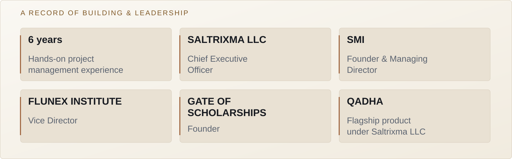
</picture>

- Leads Saltrixma LLC as CEO, overseeing product direction and digital systems delivery.
- Founded Superior Multiskills Institution and Gate of Scholarships.
- Serves as Vice Director of Flunex Institute.
- Directed QADHA’s product definition and development under Saltrixma LLC.
- Structured digital operating models around education and institutional workflows.

<h2 align="center"> 06 / Operating Principles</h2>

<picture>
  <source media="(max-width: 900px) and (prefers-color-scheme: dark)" srcset="assets/dossier/principles-dark-mobile.svg">
  <source media="(max-width: 900px) and (prefers-color-scheme: light)" srcset="assets/dossier/principles-light-mobile.svg">
  <source media="(prefers-color-scheme: dark)" srcset="assets/dossier/principles-dark.svg">
  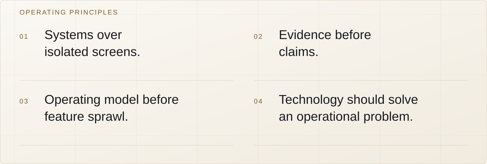
</picture>

**Start with the operation.** Understand the organization, its people and its constraints before choosing technology.

**Build connected systems.** Define the workflow, responsibilities and rules before expanding the feature set.

**Make the work visible.** Ownership, decisions and operational evidence should be clear to the people running the system.

**Let evidence set the claim.** Product status, technical scope and public proof should stay aligned.

<picture>
  <source media="(max-width: 900px) and (prefers-color-scheme: dark)" srcset="assets/dossier/workflow-dark-mobile.svg">
  <source media="(max-width: 900px) and (prefers-color-scheme: light)" srcset="assets/dossier/workflow-light-mobile.svg">
  <source media="(prefers-color-scheme: dark)" srcset="assets/dossier/workflow-dark.svg">
  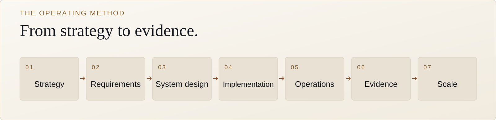
</picture>

An operating method: define the need, build the system, run the workflow and validate the evidence before scaling.

<h2 align="center"> 07 / GitHub Activity</h2>

<picture>
  <source media="(max-width: 900px) and (prefers-color-scheme: dark)" srcset="assets/dossier/github-dark-mobile.svg">
  <source media="(max-width: 900px) and (prefers-color-scheme: light)" srcset="assets/dossier/github-light-mobile.svg">
  <source media="(prefers-color-scheme: dark)" srcset="assets/dossier/github-dark.svg">
  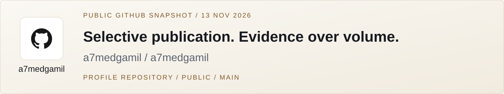
</picture>

Public repositories are used selectively for work intended for open publication. The products and institutional systems described above are represented here through public-safe evidence; their source code is not published in this profile.

**Selected public case studies**

- [MIYTO Smart Rooms — product and engineering case study](https://github.com/a7medgamil/miyto-smart-rooms-showcase)
- [QADHA Platform — product case study](https://github.com/a7medgamil/qadha-platform-showcase)
- [SMI Digital Operations — institutional case study](https://github.com/a7medgamil/smi-digital-operations-showcase)
- [AIU Smart HR & NLP CV Summarizer — academic design case study](https://github.com/a7medgamil/aiu-smart-hr-showcase)

**Portfolio case studies:** [MIYTO](https://ahmed-gamil-portfolio.ahmedabdulbarim.workers.dev/case-studies/miyto-smart-rooms) · [SMI Digital Learning & Operations](https://ahmed-gamil-portfolio.ahmedabdulbarim.workers.dev/case-studies/smi-digital-learning-platform) · [SMI Registration Hub](https://ahmed-gamil-portfolio.ahmedabdulbarim.workers.dev/case-studies/smi-registration-hub) · [AIU HR & NLP](https://ahmed-gamil-portfolio.ahmedabdulbarim.workers.dev/case-studies/hr-nlp-cv-summarizer)

[Explore public repositories →](https://github.com/a7medgamil?tab=repositories)

<h2 align="center"> 08 / Professional Connections</h2>

<picture>
  <source media="(max-width: 900px) and (prefers-color-scheme: dark)" srcset="assets/dossier/connect-dark-mobile.svg">
  <source media="(max-width: 900px) and (prefers-color-scheme: light)" srcset="assets/dossier/connect-light-mobile.svg">
  <source media="(prefers-color-scheme: dark)" srcset="assets/dossier/connect-dark.svg">
  
</picture>

<a href="https://github.com/a7medgamil">GitHub · a7medgamil</a> · <a href="https://ahmed-gamil-portfolio.ahmedabdulbarim.workers.dev">Executive Portfolio</a> · <a href="https://saltrixma.com">Saltrixma LLC</a> · <a href="mailto:ahmed@saltrixma.com">ahmed@saltrixma.com</a>

<h2 align="center"> 09 / Partnership</h2>

<a href="https://saltrixma.com/contact">
<picture>
  <source media="(max-width: 900px) and (prefers-color-scheme: dark)" srcset="assets/dossier/cta-dark-mobile.svg">
  <source media="(max-width: 900px) and (prefers-color-scheme: light)" srcset="assets/dossier/cta-light-mobile.svg">
  <source media="(prefers-color-scheme: dark)" srcset="assets/dossier/cta-dark.svg">
  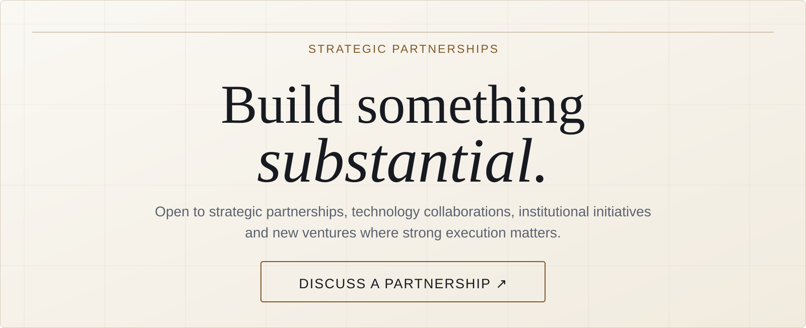
</picture>
</a>

Open to strategic partnerships, technology collaborations, institutional initiatives and new ventures where strong execution matters.

<strong><a href="https://saltrixma.com/contact">Discuss a Partnership →</a></strong>

<picture>
  <source media="(max-width: 900px) and (prefers-color-scheme: dark)" srcset="assets/dossier/signature-dark-mobile.svg">
  <source media="(max-width: 900px) and (prefers-color-scheme: light)" srcset="assets/dossier/signature-light-mobile.svg">
  <source media="(prefers-color-scheme: dark)" srcset="assets/dossier/signature-dark.svg">
  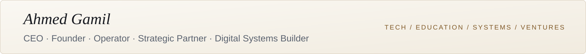
</picture>
