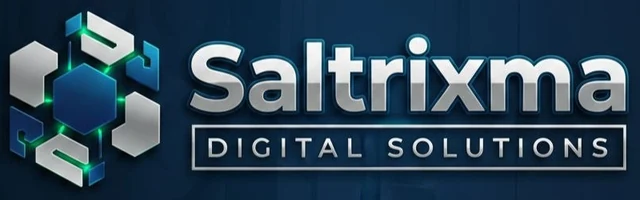
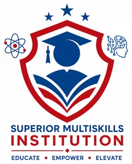
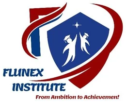
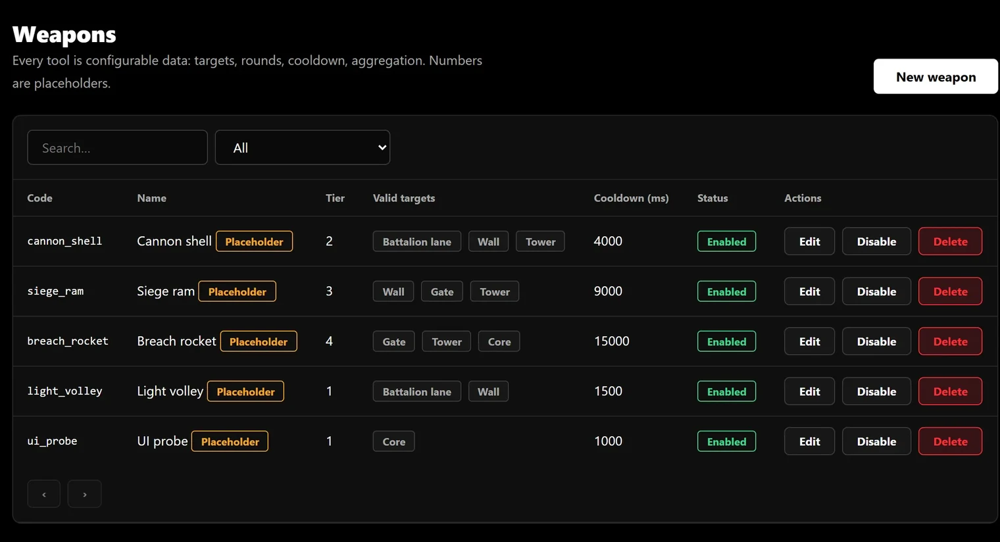

<picture>
  <source media="(max-width: 600px) and (prefers-color-scheme: dark)" srcset="assets/hero/hero-dark-mobile.svg">
  <source media="(max-width: 600px) and (prefers-color-scheme: light)" srcset="assets/hero/hero-light-mobile.svg">
  <source media="(prefers-color-scheme: dark)" srcset="assets/hero/hero-dark.svg">
  
</picture>

[Profile](#profile) · [Ventures](#leadership--ventures) · [Systems](#featured-systems--products) · [Capabilities](#technical-operating-stack) · [Principles](#engineering--product-philosophy) · [GitHub](#github) · [Connect](#build-something-substantial)

## Profile

**Ahmed Gamil**  
Founder · Operator · Strategic Partner · Digital Systems Builder

I work across technology, education, digital products and institutional systems. With **6 years of hands-on project management experience**, I turn complex requirements into operating structures, products, workflows and technical systems.

My work connects strategy with execution: defining what should be built, structuring how it should operate, and coordinating delivery around real organizational needs.

## Leadership & Ventures

<h3> Saltrixma LLC</h3>

**Founder & Managing Director**  
A digital systems and technology venture building products, operational tools and structured technical solutions. QADHA is its flagship digital product.

[Company website →](https://saltrixma.com)

<h3> Superior Multiskills Institution</h3>

**Founder & Managing Director**  
An operating education institution combining English-language learning, structured academic operations, secondary practice and mental training, supported by digital systems.

<h3> Flunex Institute</h3>

**Vice Director**  
Education and institutional leadership focused on operations and program execution.

[Institute website →](https://flunexinstitute.com)

<h3> Gate of Scholarships</h3>

**Founder**  
A scholarship-focused initiative.

## Featured Systems & Products

<h3> QADHA · قدها</h3>

**Flagship digital product developed under Saltrixma LLC**

A social video and challenge application bringing content, interaction, messaging, competitive rounds, teams and gifting concepts into one product, with an operational administration layer.

**My role:** product direction, operating model, requirements, system definition and execution oversight under Saltrixma LLC.

- **Mobile application:** Android beta; iOS release pending.
- **Operations console:** internal.
- **Battle authority:** built; the media layer is simulated.
- **Economy and ledgers:** demo / test economy, with no real payments connected.
- **Authorized content migration:** internal, with a rights gate.

Live video integration, cinematic battle rendering, app-store billing and payouts remain proposed.

Operations-console evidence from the executive portfolio. Internal development environment; tool values are placeholders. Open the image for detail. This capture does not establish public launch or live video availability.

**Documented technology:** React Native · Expo · Next.js console · PostgreSQL.  
[Public product website →](https://qadhaapp.com)

### SMI Digital Operations Ecosystem

Coordinating student, academic, assessment, reporting and administrative workflows inside Superior Multiskills Institution.

**My role:** Founder & Managing Director — institutional operating model, requirements, execution and system oversight.

The documented operating scope includes Student Gateway, attendance, sessions, learning materials and homework, assessments, progress reports, certificates, scheduling, teacher/admin operations and mental training.

Operating scope is documented in the institutional record. Approved operational screenshots and public deployment evidence are not yet available.

## Technical Operating Stack

**Frontend & Interface**  
HTML5 · CSS3 · Tailwind CSS · JavaScript · TypeScript · React · Next.js

**Backend & Application Logic**  
PHP · Laravel · Node.js · Express.js · NestJS

**Data & Cloud**  
MySQL · PostgreSQL · MongoDB · Redis · Supabase · Cloudflare R2

**Mobile Applications**  
Flutter · React Native · Expo · Mobile Backend Integration

**Infrastructure & Deployment**  
Docker · cPanel Administration · Domain & DNS Management · Cloudflare · Nginx · Vercel

**APIs & Real-Time Systems**  
REST API Development · Third-Party API Integration · Webhooks · WebSockets · LiveKit

**Security, Testing & Engineering**  
OWASP Top 10 · Playwright · Git & GitHub · GitHub Actions

**AI, Architecture & Product Engineering**  
OpenAI API Integration · n8n Automation · System Architecture · Full-Stack Integration · Requirements Analysis · Technical Project Planning

## Verified Milestones

- Founded Saltrixma LLC, Superior Multiskills Institution and Gate of Scholarships.
- Serves as Vice Director of Flunex Institute.
- Directed QADHA’s product definition and development under Saltrixma LLC.
- Structured digital operating models around education and institutional workflows.

## Engineering & Product Philosophy

**Start with the operation.** Understand the organization, its people and its constraints before choosing technology.

**Build connected systems.** Define the workflow, responsibilities and rules before expanding the feature set.

**Make the work visible.** Ownership, decisions and operational evidence should be clear to the people running the system.

**Let evidence set the claim.** Product status, technical scope and public proof should stay aligned.

## GitHub

Public repositories are used selectively for work intended for open publication. The products and institutional systems described above are represented here through public-safe evidence; their source code is not published in this profile.

[Explore public repositories →](https://github.com/a7medgamil?tab=repositories)

## Professional Connections

[GitHub · a7medgamil](https://github.com/a7medgamil) · [ahmed@saltrixma.com](mailto:ahmed@saltrixma.com)

## Build something substantial.

Open to strategic partnerships, technology collaborations, institutional initiatives and new ventures where strong execution matters.

**[Discuss a Partnership →](https://saltrixma.com/contact)**
